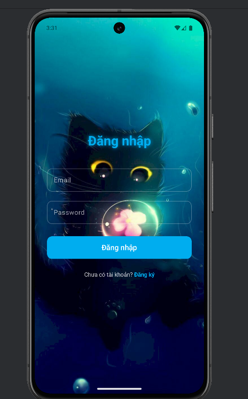
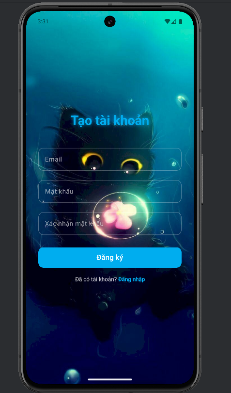
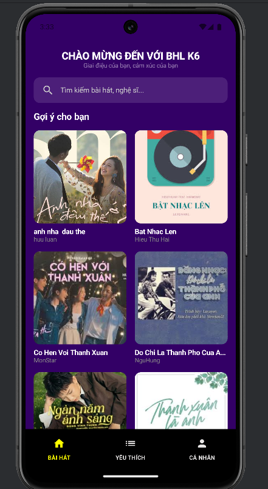
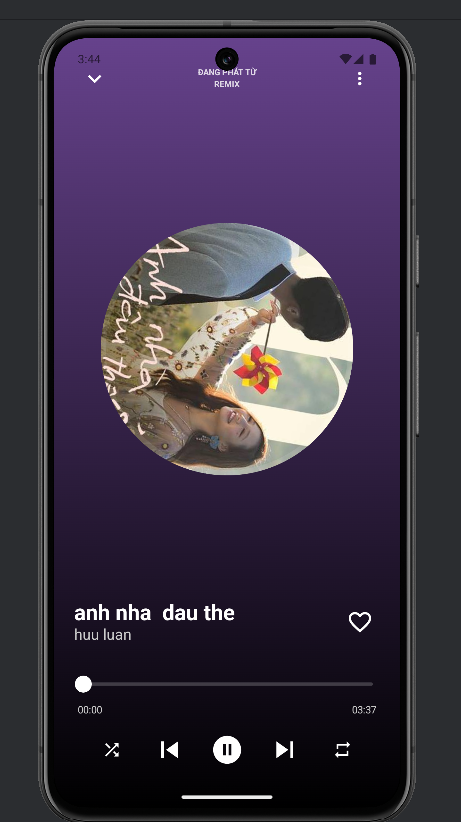
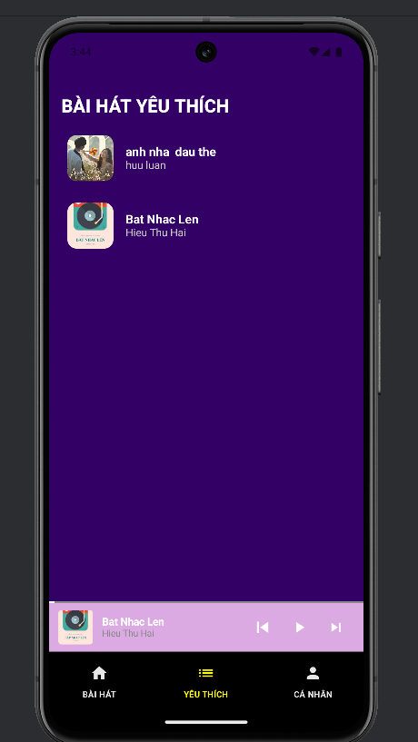
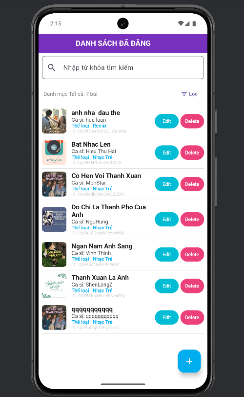
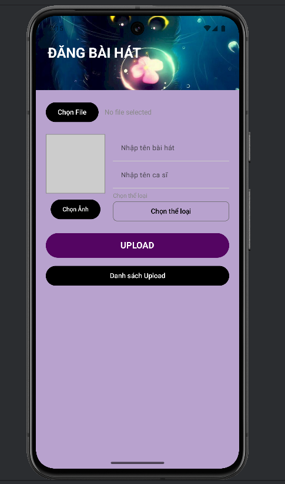
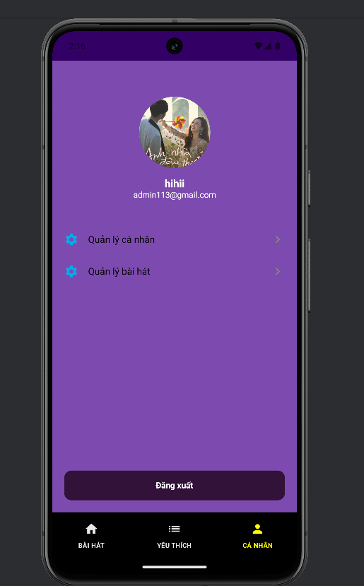
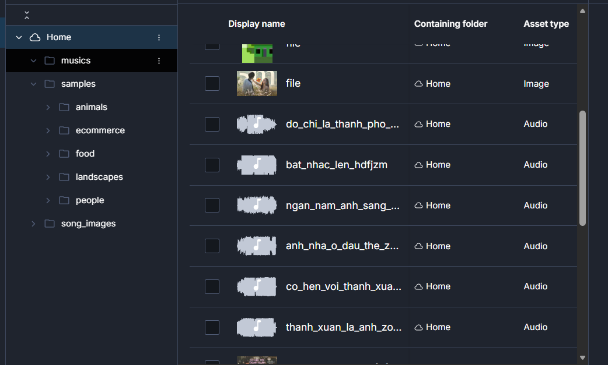

# 🎵 MyAppMusic — Ứng dụng Nghe Nhạc Android

Ứng dụng nghe nhạc trực tuyến được xây dựng bằng **Kotlin + Jetpack Compose**, sử dụng **Firebase Authentication** và **Cloudinary** để quản lý người dùng và lưu trữ media.

---

## 📸 Giao diện ứng dụng

### 1. Đăng nhập


### 2. Đăng ký tài khoản


### 3. Trang chủ (Danh sách bài hát)


### 4. Phát nhạc


### 5. Bài hát yêu thích


### 6. Quản lý bài hát (Admin)


### 7. Đăng bài hát mới (Admin)


### 8. Trang cá nhân (Admin)


### 9. Danh sách nhạc


---

## 🌟 Tính năng chính

### 👤 Người dùng
- Đăng ký / Đăng nhập bằng Email + Password (Firebase Auth)
- Xem danh sách bài hát gợi ý
- Tìm kiếm bài hát
- Phát nhạc (play, pause, next, previous)
- Thêm / xóa bài hát yêu thích
- Xem thông tin cá nhân

### 🛡️ Quản trị viên (Admin)
- Đăng bài hát mới (upload audio + ảnh bìa)
- Quản lý danh sách bài hát đã đăng (Edit / Delete)
- Phân loại thể loại nhạc
- Quản lý thông tin cá nhân

---

## 🛠️ Công nghệ sử dụng

| Thành phần              | Công nghệ                          |
|-------------------------|------------------------------------|
| Ngôn ngữ                | Kotlin                             |
| UI                      | Jetpack Compose                    |
| Authentication          | Firebase Authentication            |
| Database                | Cloud Firestore                    |
| Lưu trữ Media           | Cloudinary                         |
| Architecture            | MVVM + Repository Pattern          |
| Dependency Injection    | Manual / ViewModel                 |

---

## 📁 Cấu trúc thư mục
app/
├── gui/                  # Các màn hình (Login, Home, Player, Admin...)
├── model/                # Song, User
├── repository/           # Firebase + Cloudinary Repository
├── ui/theme/             # Color, Theme
├── viewmodel/            # ViewModels
└── MainActivity.kt

---

## 🚀 Hướng dẫn chạy dự án

### Yêu cầu
- Android Studio Ladybug trở lên
- JDK 17
- Emulator hoặc thiết bị Android thật

### Các bước

1. **Clone repository**
   ```bash
   git clone https://github.com/lhluann/MyAppMusic.git
   cd MyAppMusic
   👨‍💻 Tác giả
Developer: Lâm Hữu Luân
GitHub: lhluann
Tên app: BHL K6 / MyAppMusic
